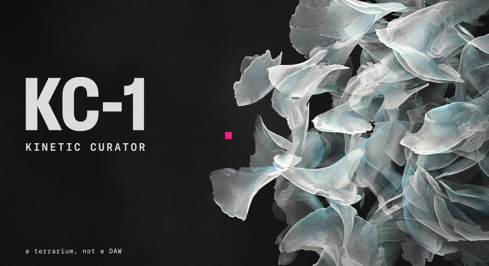

# Kinetic Curator

**KC-1** — a generative art instrument for live visual performance. React + Vite + one WebGL2 pipeline. What plays is what renders.

Live: [neuralio444.github.io/Kinetic_Curator](https://neuralio444.github.io/Kinetic_Curator/)



*A terrarium, not a DAW.* You curate plates, palettes, and voices. The seed and the wind do the rest.

**Release on `main` (2026-10-27):** **[0.9.0](CHANGELOG.md)** + everything since: the petri dish, five materials, the Look Explorer, the loot folder, a second taste head, the spectral path — and now the creature system, the ROOM codec, 64 looks × 64 voices under a tap-cycled KINETIC ceiling, the Mind trio's first live stages, travel kinemes, and the determinism audit. Engine spines A–G merged, governor R1–R4 landed, Night Migration 30/60 sign-off recorded ([docs/EMBARGO.md](docs/EMBARGO.md) — Stage 1 unfrozen). Roadmap: [docs/ROADMAP_V1.md](docs/ROADMAP_V1.md). See [Now](#now-on-main).

## Now on main

The picture has mass and the flock keeps its own clock (dt loop, heading spring, shared wind). What plays is what renders, at one readout.

**Connected and live**

- One WebGL2 loop for canvas and stills (`app/src/gl/liveLoop.mjs`); SVG emitter is a dev-only parity reference.
- Kernel v1 — index-stable placements, channel RNG, sampler registry, K3–K5. SoA swarm with reference-parity goldens.
- Engine spines A–G: dt clock, atlas-cell skip, heading spring + ballistics + life, live mask tint, mode-chip dissolve + slider springs, shared noise + curl wind, bufferSubData.
- PATCH on the track: OFF / MOD / FIELD / FEED with per-mode strength sliders, stable-id targets, and an inline live readout under each patched row (#506 / #507).
- Math matrix, phases 1–2: MOD steering (source motion retunes target weights) and one shared scent field across layers (#509).
- Voice + preset MIX (stepped color, smooth palette, no rebake) with morph-ease arrival; flagship voices + curated road (motion factors #515–#519 filed).
- Flagship voices, 4 content-track cap, track patch round-trip + cap on load, H/M/L asset locker, FADE on the palette bar.
- ACCUM trails, GPU FX (chain compiler + template effects + cost tiers + measured costs), showrunner shed ladder behind one tape readout (budget knob, named stages, FX-stack weight).
- Behave profiles + bio-drives (drives, scent, mold, graze, leak, swell) on one integrator. Seven verbs: cruise, flock, orbit, scatter, mold, levy, lorenz. Audio ballistics shape mic input and the GL loop.
- **Petri dish** (#1183, #1417–#1425) — one world: marks lean toward, rest on and take the colours of the pattern tile beneath them; shared contact grid across strata; DISH switch with bounce/repel. Roadmap: [docs/ROADMAP_PETRI_DISH.md](docs/ROADMAP_PETRI_DISH.md).
- **Stress + bands** (#1362, #1363) — one stress value (instrument load, performer activity, dish pressure, taste pressure) with smoothing and hysteresis; Relax / Normal / Tighten bands; recorded in every take.
- **Wet lab + creatures** (#1377–#1381, #1400, #1418–#1429) — pin a place, and when the field and crowd allow, a moth grows there (body, wings, ATTACH points, second wing pair in a crowd). Davis gives it traits once at birth; the room tightens or loosens his range.
- **Performance files** (#1339, #1360) — record, export, import and replay a take; checkpoints verify the replay.
- **DIRECTORS panel** (#1126; formerly DAVIS, #830) — LOIS (NOD / VIBE / BURN / AWAY) vs Davis (FLOW / SEEDLING / UGLY / STUCK / BLOOM), both reading the honest feed; the panel hosts the argument. VOICES / GENERATE / PERFORM live here (flagship voices load-only, ✎ fork dish into MY VOICES), Evolve with live progress, phrase clock readout, ACCUM gestures.
- **PATTERN tracks** (#1039–#1042) — FIELD / QUILT / GLYPH modes in BUILD (add / edit / shuffle), with per-mode DRIFT, DROP gate, bar-quantized shuffle, and per-element kinemes; KIN and CURATOR rolls deal element motion too.
- **Slider dialogs** (#1127) — tap a slider's name for range expansion and mode switch; ROTATE defaults to continuous SPIN in rev/s, every mark with its own speed and direction.
- **Keep recall + recipes** (#996) — clicking a keep brings its tracks back (recall + morph, one undo); K keeps without starring; share links, recipe text and keeps carry the whole layer stack.
- **Web MIDI** (#617) — engine merged, mappings saved in the project; learn mode shipped (#1721: arm a row, touch a pad/knob, bound); setup is a popup modal with a bank layer and an on-screen key legend (#1724, #1726); note/CC binds (#1749). Remainder: the iPad BLE-MIDI path.
- **Palette lab** (#953) — generate / edit / save / import / export; 37 palettes on the KIN strip.
- **WET engine** (#970) — standalone wetness service (WETNESS slider, vortex-particle core); ACCUM is one consumer.
- **MATH track** (#1010) — 12 tone ops on the FX fold, assignable macro knobs (#724).
- **Top bar** (#1103) — cold open, CUR and BEAT beside it; BEAT is the BPM master clock.
- **Pipeline SETUP + STAGE** (#606–#608) — canvas presets (VJ and social sizes), W×H lock/swap, capture fps. The live raster *and* the scene follow the authored size: a new aspect reveals more or less canvas, it never stretches the content. Stage: preview / fullscreen (Tauri stage window when native) / Syphon (honest not-linked status for now).
- **Audio as data** (#790, #613, #615, #618) — METER with seven named bands, an editable modulation MATRIX (band → target → depth, up to 16 routes, saved with the project, undoable), FEEL presets (Gentle / Punchy / Violent), and a FILE source with a `kc-audio-envelope/1` sidecar for deterministic reactivity.
- **CHIAROSCURO sun** (#594) — one scene-level light with per-instance diffuse, bevel-from-alpha normals, and squash-and-stretch (SQUASH) so moving marks keep their mass. DARK GLASS voice (#704). Gate weave (#741), FXAA (#740), ACES + Bayer resolve (#532).
- **Kinemes** (#781) — whole-mark motion (spin / rock / pulse / blink / bob) assigned per asset, evaluated in the vertex shader; no asset or atlas changes.
- **Per-node uniqueness** (#558) — no two nodes in lockstep: seeded per-agent phase, drift/speed multipliers and noise seed; legacy seeds stay bit-identical. Diorama parallax on zTiers (#796).
- **Taste curator** (#762) — import a Studio `taste.json`; CURATE picks with its head; `validate-taste.mjs` checks the file honestly. The head can now be a **tree head** (#1579–#1581): an XGBoost ensemble distilled on the Studio, printed as plain trees inside the same taste.json. The dice are ordered within their family strata by score (scores never gate the deal), every pick is stamped with score + taste version + head kind, a census readout reports how far the head and the room agree, and Davis cites the splits behind a pick. The machinery is in; the first trained tree head ships from a Studio run.
- **Materials** (#1547–#1549) — five mark bodies render in GL: flat, glass (translucent), plate (radial ink body), wash, stipple. The vocabulary is complete.
- **Look Explorer** (E1a–E5: #1504–#1508, #1530) — the instrument mines its own unvisited territory: a coverage census and a parameter census as standing instruments, a stratified miner, the mined tray in DIRECTORS, persona prospecting corners with LOIS judging real renders, and a Davis variants offspring engine for the library. The dice feeding it were repaired too — starved families get their own casts (#1546) — and the write path has one ranges source of truth (#1550).
- **Loot folder** (#1479) — a local folder is a library: pick or create one in the app and KC-1 scans it. SVGs join the asset pool, palette files join the palette library, audio joins the sources. Missing files are said out loud, never silently dropped.
- **Spectral path** (#1482, #1483) — bands modulate, spectrum structures: an analysis core, a live readout in STIMULI, and marks that listen to spectral features. Trio audio direction, stage 1: LOIS's keep-rate moves how soon she calls a show flat.
- **Samplers and verbs** — truchet, voronoi-masked scatter, l-system growth, phyllotaxis; seek/flee behave rows; Markov transition weights; euclidean phrase clock.
- **Shell** — Curator cluster (LOOKS / VOICE / Curator) lives in the top bar; 4-state shape intensity mixer (#733); FADE is now a real per-node colour transition (#632); taxonomy LOOK / VOICE / SYSTEM / CAST ([docs/TAXONOMY.md](docs/TAXONOMY.md)).
- **Color modes** — FADE (the default melt), WASH (soak from the middle outward), INJECT (field dyes first, agents catch up). One slider, seconds.
- **Asset Studio** — merge assets with chamfer + live blend preview.
- **Living boot** — First Light starters: the instrument wakes up playing.
- **Halo** — soft wide bloom + vignette tuned for dark grounds.
- **Phyllotaxis sampler** — fibonacci's sibling; the DIVERGENCE slider re-counts the spiral arms.
- **Joiner/leaver** — obvious face / invisible face pairing.
- **DEV panel** — Shader Lab + X-Ray + Gov Tune in one place.
- **Creature system** (#1634, #1657–#1662, #1694, #1723) — one seeded mirrored skeleton draws all four types: the moth, robots (0° / 45° / 90° detents), L-system growths, and the glitch; many layered parts with an engraving finish. Wet Lab H/L markers (tap cycles plain → H → L → gone) designate head and limbs; the dish body carries slime as a material; dish pressure sizes limb growth; the band's material reaction starves or flourishes the body. Creatures spawn through the normal asset path. **ALife** (#1731, #1732, #1734–#1738; PR #1757) — bounds, dot-product facing, genome / drives / dreaming in the engine.
- **KINETIC variety** (#1766; slices #1767–#1772, PR #1778) — 64 looks, 64 voices, and roll pools dealt from the whole library; a tap sweeps look → voice → the curator's capped nudge. The START pill tap-cycles the ceiling OFF → WEAK → MED → KOZ, with the deck readout beside it: 49 assets / 33 looks / 19 voices at OFF, 294 library assets at WEAK, 64 looks + 64 voices at MED and KOZ. Warm taps no longer re-roll accumulation blur (#1768).
- **ROOM codec** (#1560; PRs #1727–#1730) — the directors' room as a live codec: face windows over a bus transcript, generative faces (Davis colour-Bayer dither, LOIS glyph dither), a story machine (relationship model, story generator, suspicion arc), and an offline-curated lore bank (`lore.json`) whose cold opens run through the story machine.
- **Mind trio** (#1483; PRs #1783–#1785) — a spectrum summary in the show block (centroid, flux, flatness); LOIS judges the spectrum (a held or noise-wall spectrum reads flat, a moving one rides); the trio wakes on the next bar and stops when the audio goes off. Stages 1–2 + acceptance shipped; MegaMind stays a design doc.
- **Travel kinemes** (#1574–#1576, #1712–#1714) — transport core (FLOW sim + leash), PATH transports with per-stratum leashes, SURGE and parallax drift; the Queen stamps the trigger.
- **WEATHER dial** (#1183; PR #1703) — slice 1: the per-content-layer dial drinks the haze of the nearest FX layer above it.
- **The three reads** (#1627; PR #1717) — scale-band meter, mark-born weather, the duel. **STIMULI feedback warp** (#1490; PR #1722) — the previous frame, warped by the music. **Retroactive capture** (#1367; PR #1696) — save the last few minutes after something good happens.
- **Nothing is ever silently lost** (#1641–#1646; PRs #1697–#1702) — shelf persistence, taste labels, loot index, bounded logs, catch-alls; nine surfaces speak.
- **Determinism audit** (PRs #1663–#1681) — `Math.random` defaults dropped from the live path, an ESLint determinism wall, cache/uniform fixes. **CI replay gate** (#1638; PR #1693) — a recorded take replayed and hash-compared in selfcheck; takes record their spectrum (#1534; PR #1692). **Device budgets** (#1639; PR #1695) — frame budgets for desktop + iPad judged from the harness.
- **Prettier** (PRs #1755–#1779) — a repo-wide format standard, enforced. **Desktop shell** — the Tauri build lives in `src-tauri`; CSP hardening (#1707; PR #1782) and fs-scope fixes (PR #1752).

**Not done (do not advertise as shipped)**

- Evolve seed-jitter glide, editable BEHAVE weights (#471 / #479).
- Governor cost head (#1578) — the evaluator is merged and inert: no trained model, nothing calls it yet. The reactive governor remains the only governor.
- MegaMind — designed and deferred. Mind's trio layer is live (above); its later stages are not built.
- Band-pair closer (#1635) — band-edge evidence from real takes landed (#1758); the final phase (≥5 real sessions + the 0.28 / 0.72 edge verdict) is still open.
- Syphon / NDI output (STAGE shows an honest not-linked state), colour space waits on #532 ACES.
- Per-asset sub-animation frame strips (#699 — reverted; kinemes are the path).
- OSC build, mobile pass, live-output path (roadmap Stages 2–3); MIDI's remainder is the iPad BLE-MIDI path (#617).
- Matt-only: icons (#346), M3 calibration (#298), iPhone pass (#270).

**Embargo:** lifted 2026-09-23 (Night Migration sign-off). Stage 1 unfrozen; deferred pile still waits. Plan: [docs/EMBARGO.md](docs/EMBARGO.md). Agents: [AGENTS.md](AGENTS.md) + [docs/ROADMAP_V1.md](docs/ROADMAP_V1.md).

## Philosophy

Not a blank canvas. You assign palettes and instruct placement DNA. *We are not painting; we are breeding variations in a terrarium.* Ghost Station (`E` Evolve) mutates; you snapshot (`S`) and favorite (`F`).

## Reproducibility

**Full project JSON** (OUTPUT → ↓ PROJECT) is the unit: seed, palette, layout, assets, weights, quality, layers.

- Index `i` keeps scale / rotation / alpha / asset / color when count changes.
- RNG channels: `dens` / `geo` / `attr` / `asset` / `color` / `noise` / `dyn`.
- `createNoise(seed)` — no global perm table.
- Golden fixture: **`kernel.v1`**. 0.8 seeds will not match pixel-for-pixel.
- Audio, LFO life, Evolve are **live-only**. Still hashes ignore them.
- RENDER FINAL matches the live preview (UNCAPPED off). ACCUM stills export the trail buffer.

## Features

- **Live instrument** — Fibonacci, Phyllotaxis, Grid, CA, Orbit, Flow, Swarm, Stratified, … same GPU as exports.
- **Stills** — GPU readback 1×–8K PNG + JSON sidecar; default size follows the SETUP canvas.
- **Parity** — `npm run selfcheck`; under 10% pixel vs the SVG reference is a pass.
- **FX** — rgbSplit, displace, tear, grain, scanlines, posterize, invert, solarize, edge (+ template effects, no runner change per effect). Chain compiler + cost tiers + measured costs.
- **ACCUM** — phosphor trails, bloom / halation / stipple. FREEZE / CLEAR. Silence is a no-op.
- **Governor** — one tape readout (budget knob, named shed stages, FX-stack weight). The ladder sheds pixels before visible things, FX never culled.
- **Tracks** — KC-1…KC-4 + FX slots (tap-to-arm ghosts); patch links with live readouts; stable-id targets.
- **Audio** — mic or file (live FFT or a pre-analysed sidecar) → editable route matrix: scale, opacity, evolve-on-beat, ballistics-shaped envelopes.
- **Director** — Evolve, morph, phrase clock, LFO life, BEHAVE readout, voices.
- **Hits** — 1–9 recall, Enter advances.
- **Colour** — slot edit / locks, library, harmony + shuffle, FADE / WASH / INJECT.
- **Organisms** — moth / petal bodies, flap, breath, named behave profiles, bio-drives (hunger, scent, mold, graze, leak).
- **Assets** — drop SVG, tags, H/M/L, DUP. Asset Studio: merge with chamfer + live blend preview. Lab / species editor is deferred.
- **Studio farm** — `studio/studio.py` stills, ACCUM, batch, ffmpeg video, gated Curator CLIP.

## Stack

React 19 · Vite 8 · Zustand + `useApp` · `engine/kernel/*` · `app/src/gl/*` · CSS variables · Playwright + `selfcheck`.

## Install

```bash
git clone https://github.com/NeuralIO444/Kinetic_Curator.git
cd Kinetic_Curator/app
npm install
npm run dev
```

http://localhost:5173/Kinetic_Curator/

| Command | Purpose |
|---------|---------|
| `npm run dev` | Vite |
| `npm run build` | Production |
| `npm run lint` | ESLint |
| `npm run selfcheck` | Golden hash + kernel / GL / governor |
| `npm run test:e2e` | Playwright |
| `npm run preflight` | lint → selfcheck → build → e2e |

```bash
python3 studio/studio.py render my.project.json -o out.png --res 7680x4320 --sidecar
python3 studio/studio.py render my.project.json -o trails.png --accum --steps 24
python3 studio/studio.py batch my.project.json -o editions/ --count 500 --start-seed 0 --res 2
python3 studio/studio.py video my.project.json -o out.mp4 --fps 30 --duration 4 --res 1920x1080
```

Needs `ffmpeg` for video and `cd app && npx playwright install chromium` for GPU farm paths.

## Deploy

Pages is already on **GitHub Actions** → [live site](https://neuralio444.github.io/Kinetic_Curator/). Vercel: `vercel.json` builds `app/` with `VITE_BASE=/`. Netlify: `cd app && npm ci && VITE_BASE=/ npm run build` → `app/dist`.

## Docs

- [Engine plan](docs/archive/ENGINE_PLAN.md) — spine A–G, do not redo shipped MIX/MOD
- [Embargo](docs/EMBARGO.md) · [Two planes](docs/TWO_PLANES.md) · [Tempo](docs/TEMPO_AND_CHIPS.md)
- [GL contract](docs/GL_CONTRACT.md) · [ACCUM](docs/ACCUM.md) · [Showrunner](docs/SHOWRUNNER.md)
- [Organic motion](docs/ORGANIC_MOTION.md) · [Noise](docs/NOISE_AND_LAYERS.md) · [Tracks](docs/KC1_LAYERS.md)
- [Petri dish roadmap](docs/ROADMAP_PETRI_DISH.md) · [Release roadmap](docs/ROADMAP_V1.md) · [DLC preset types](docs/DLC_PRESET_TYPES.md)
- [Manifesto](docs/MANIFESTO.md) · [Changelog](CHANGELOG.md) · [Buglist](docs/BUGLIST.md)

## Hotkeys

`Space` pause · `S` snap · `F` favorite · `E` Evolve · `N` new seed · `G` fullscreen · `Cmd+Z` undo · `?` overlay · `1–9` hits · `Enter` advance setlist

## License

MIT. See `LICENSE`.
